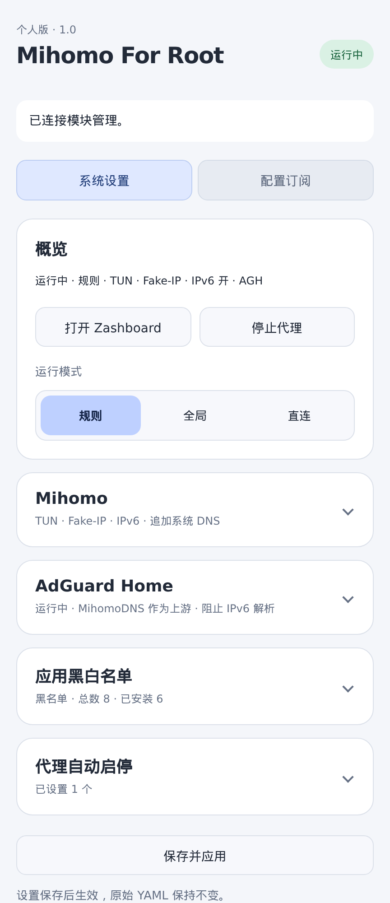
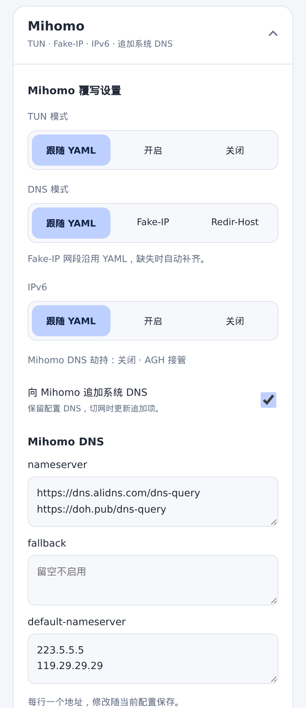
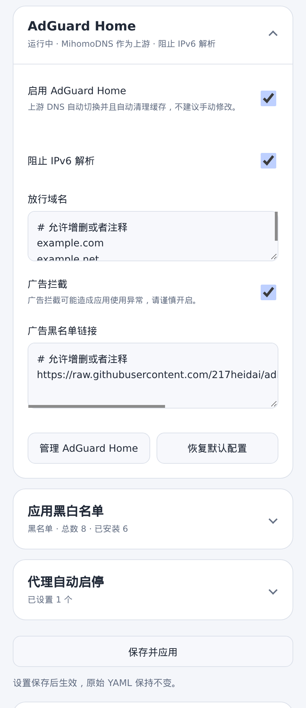
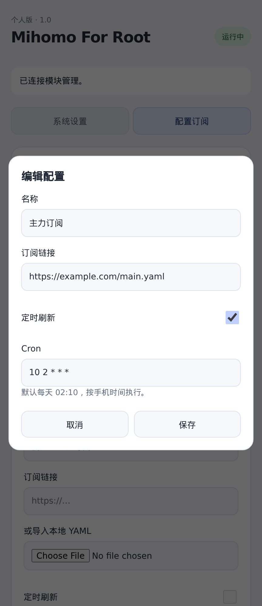
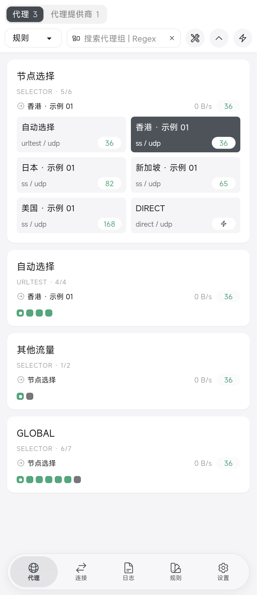

# Mihomo For Root

## 致谢

感谢以下开源项目及数据维护者。本项目修改自 **boxproxy/box**，保留原项目及第三方许可证。

| 用途 | 项目 |
|---|---|
| 源项目 | [boxproxy/box](https://github.com/boxproxy/box) |
| 上游实现与参考 | [taamarin/box_for_magisk](https://github.com/taamarin/box_for_magisk)、[CHIZI-0618/box4magisk](https://github.com/CHIZI-0618/box4magisk)、[AndroidTProxyShell](https://github.com/CHIZI-0618/AndroidTProxyShell) |
| 代理核心 | [MetaCubeX/mihomo](https://github.com/MetaCubeX/mihomo) |
| DNS 过滤 | [AdGuard Home](https://github.com/AdguardTeam/AdGuardHome) |
| 代理面板 | [Zashboard](https://github.com/Zephyruso/zashboard) |
| 中国大陆应用清单 | [mnixry/direct-android-ruleset](https://github.com/mnixry/direct-android-ruleset) |
| 推荐代理应用清单 | [2dust/v2rayNG](https://github.com/2dust/v2rayNG) |
| 广告过滤订阅 | [217heidai/adblockfilters](https://github.com/217heidai/adblockfilters) |
| GeoIP、GeoSite、Country、ASN 数据 | [MetaCubeX/meta-rules-dat](https://github.com/MetaCubeX/meta-rules-dat) |
| 配置处理与下载 | [yq](https://github.com/mikefarah/yq)、[curl](https://github.com/curl/curl) |
| Shell 工具与本地管理服务 | [BusyBox](https://busybox.net/) |
| Root 模块生态 | [Magisk](https://github.com/topjohnwu/Magisk)、[KernelSU](https://github.com/tiann/KernelSU)、[APatch](https://github.com/bmax121/APatch) |

数据库与过滤规则的上游致谢

以下为数据制作、汇总与过滤规则涉及的上游；具体收录内容随上游更新。

- **数据库制作与来源**：[Loyalsoldier/v2ray-rules-dat](https://github.com/Loyalsoldier/v2ray-rules-dat)、[CHIZI-0618/v2ray-rules-dat](https://github.com/CHIZI-0618/v2ray-rules-dat)、[Loyalsoldier/geoip](https://github.com/Loyalsoldier/geoip)、[xishang0128/geoip](https://github.com/xishang0128/geoip)、[MaxMind GeoLite2](https://dev.maxmind.com/geoip/geolite2-free-geolocation-data/)。
- **域名与分类规则**：[v2fly/domain-list-community](https://github.com/v2fly/domain-list-community)、[Loyalsoldier/domain-list-custom](https://github.com/Loyalsoldier/domain-list-custom)、[felixonmars/dnsmasq-china-list](https://github.com/felixonmars/dnsmasq-china-list)、[gfwlist](https://github.com/gfwlist/gfwlist)、[cokebar/gfwlist2dnsmasq](https://github.com/cokebar/gfwlist2dnsmasq)、[Loyalsoldier/cn-blocked-domain](https://github.com/Loyalsoldier/cn-blocked-domain)、[blackmatrix7/ios_rule_script](https://github.com/blackmatrix7/ios_rule_script)、[xishang0128/rules](https://github.com/xishang0128/rules)、[XIU2/TrackersListCollection](https://github.com/XIU2/TrackersListCollection)、[WindowsSpyBlocker](https://github.com/crazy-max/WindowsSpyBlocker)。
- **AdGuard 规则**：[FiltersRegistry](https://github.com/AdguardTeam/FiltersRegistry)、[AdguardFilters](https://github.com/AdguardTeam/AdguardFilters)、[AdGuardSDNSFilter](https://github.com/AdguardTeam/AdGuardSDNSFilter)。
- **其他过滤规则**：[EasyList / EasyList China / EasyPrivacy](https://easylist.to/)、[Cats-Team/AdRules](https://github.com/Cats-Team/AdRules)、[cjx82630/cjxlist](https://github.com/cjx82630/cjxlist)、[xinggsf/Adblock-Plus-Rule](https://github.com/xinggsf/Adblock-Plus-Rule)、[damengzhu/banad](https://github.com/damengzhu/banad)、[AWAvenue-Ads-Rule](https://github.com/TG-Twilight/AWAvenue-Ads-Rule)、[hagezi/dns-blocklists](https://github.com/hagezi/dns-blocklists)、[OISD](https://oisd.nl/)、[StevenBlack/hosts](https://github.com/StevenBlack/hosts)、[Dan Pollock's hosts](https://someonewhocares.org/hosts/)、[Peter Lowe's blocklist](https://pgl.yoyo.org/adservers/)。

来源说明：[meta-rules-dat 致谢](https://github.com/MetaCubeX/meta-rules-dat#致谢)、[adblockfilters 上游规则源](https://github.com/217heidai/adblockfilters#上游规则源)。各项目与数据分别遵循其原有许可证。

## 警告与免责

> ⚠️ 本模块需要 Root 权限，可能导致断网、应用异常、循环重启，甚至无法开机（变砖）。不了解模块作用及救砖方法，请勿刷入。安装前请备份重要数据。
>
> 📌 刷入和使用风险由使用者自行承担。本项目及维护者不对使用本模块造成的损失承担责任。
>
> 📚 本项目仅用于网络技术学习与测试研究，不提供任何代理服务。使用者对自己的行为完全负责！

## 界面预览

当前页面的手机尺寸截图，使用示例配置、节点和运行状态。点击图片查看原图。

<table>
  <tr><th>概览</th><th>Mihomo 配置</th><th>AdGuard Home</th><th>订阅与定时刷新</th><th>Zashboard</th></tr>
  <tr>
    <td></td>
    <td></td>
    <td></td>
    <td></td>
    <td></td>
  </tr>
</table>

## 简介

**Mihomo For Root** 是一个面向已 Root 安卓手机的系统级透明代理模块。通过 TUN / TProxy 接管流量，**无需开启 Android VPN，也无需安装配套 APK**。

除了运行 Mihomo，还提供本地管理页面：管理订阅和应用黑白名单，按指定 Wi-Fi 自动启停代理，并可搭配 AdGuard Home 统一处理 DNS 与广告过滤。

### 主要特性

| 特性 | 能做什么 |
|---|---|
| 自动启停 | 连接指定 Wi-Fi 时暂停代理，离开后自动恢复；手动停止后保持停止 |
| 配置与订阅 | 导入完整或纯节点 YAML，多配置切换、手动或定时刷新；应用前检查，失败保留原配置 |
| 应用黑白名单 | 全部代理、仅代理选中应用、排除选中应用；可导入推荐清单，未安装包名也能预先保存 |
| 代理与内核 | 规则 / 全局 / 直连；检查更新 Mihomo，支持恢复上一版 |
| 配置覆写 | TUN、Fake-IP / Redir-Host、IPv6、DNS 劫持及 DNS 地址；不改写订阅原文件 |
| 追加系统 DNS | 保留配置原有 DNS，随 Wi-Fi / 移动网络变化追加、撤销系统 DNS 地址 |
| AdGuard Home | 上游在 Mihomo DNS 与系统 DNS 间自动切换并清缓存；支持广告过滤、阻止 IPv6 解析及指定域名放行 |
| 本地管理 | 浏览器或 PWA 管理；按需查看日志，编辑兜底 YAML，支持恢复默认配置 |

维护者：**shengshk**。当前离线包仅支持 **ARM64**，已在 **Android 16 / KernelSU 3.3** 验证。

[下载模块与校验值](https://github.com/shengshk/mihomo-for-root/releases/latest)

📦 离线安装包约 **66 MB**，包含 Mihomo、AdGuard Home、Zashboard、工具，以及 **GeoSite 域名库、GeoIP IP 库、Country 国家库和 ASN 数据库**。这些组件和数据已内置，支持离线安装，因此体积较大。

## 安装使用

1. 在 Root 管理器中安装模块，重启手机。
2. 点击模块的管理入口，或在手机浏览器打开 **http://127.0.0.1:9091/**。
3. 进入“配置订阅”，添加订阅链接或导入 Clash / Mihomo YAML，检查通过后切换。
4. 在“系统设置”调整选项，点击底部 **保存并应用**；在概览中控制代理启停。

覆盖安装保留现有配置与数据，并自动备份。
安装时可用音量键选择更新 Mihomo；跳过则保留现有或内置版本。AGH 默认关闭，按需启用。

## 管理入口

| 页面 | 手机本机地址 |
|---|---|
| 模块管理 | http://127.0.0.1:9091/ |
| Zashboard | http://127.0.0.1:9090/ui/ |
| AdGuard Home | http://127.0.0.1:9092/ |

Zashboard 端口随配置变化，从模块管理页打开可自动填写连接信息。管理页支持添加到主屏幕，作为 PWA 使用。

## 配置如何生效

**兜底 YAML → 订阅已有配置 → 管理页覆写 → 模块必要适配。** 后面的设置优先。

支持完整 YAML，也支持只包含节点或节点提供者的 YAML。缺少的分组、规则、DNS 等会自动补齐；内置兜底默认开启 TUN、Fake-IP 和 IPv6。纯节点配置切换后，需在 Zashboard 选择节点。

管理页的设置只影响手机运行配置，不改写订阅原文件。订阅新增时默认不启用定时刷新；启用后的默认计划为每天 **02:10**。

“高级配置”修改兜底 YAML；“恢复内置兜底”不会清除订阅或管理页覆写。保存前检查配置，失败保留或恢复原值。

## AdGuard Home 怎么用

启用后，手机普通 DNS 请求先进入 AGH：**Mihomo 运行时，上游使用 Mihomo DNS；Mihomo 停止时，上游使用系统 DNS**。切换上游自动清缓存，AGH 与 Mihomo DNS 劫持互斥。

- 阻止 IPv6 解析只过滤 AAAA 查询，不关闭手机 IPv6；可填写放行域名。
- 广告拦截默认关闭，启用前注意可能影响部分应用。域名、订阅链接均支持整行 `#` 注释。
- 统计和查询日志默认开启，保留 24 小时；DNS 缓存默认关闭。
- “恢复默认配置”先回填页面，点击底部“保存并应用”才重置完整 AGH 配置并重启 AGH；启用状态保留，原配置自动备份。

使用 Fake-IP 时，绕过模块的应用可能连接异常。遇到问题可将该应用加入代理，并检查 AGH 广告规则。私人 DNS、应用内 DoH 可能绕过普通 DNS 接管。

## 贡献说明

GitHub 仓库仅接受 PR，不开放 Issues。请附上清晰的问题描述、复现步骤、相关日志和截图，并说明可能的解决思路或修复方案。提交前请隐藏订阅链接、密码等私人信息。

## 构建与维护

执行 `bash build.sh`，成品输出到 `dist/`；缺少依赖缓存时，会从 `releases/` 中的离线包恢复。构建需要 Python 3、zip/unzip。

GitHub 源码不包含安装包。首次构建前，从同版本 Release 下载 `mihomo-for-root-1.0.zip`、`SHA256SUMS`、`module.json`，放入仓库的 `releases/` 目录，再运行构建。无需刷入手机即可构建。

[GPL-3.0 许可证](LICENSE)
